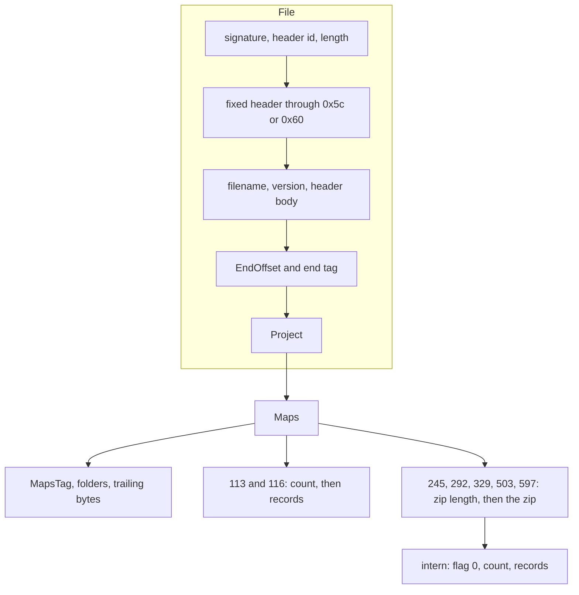

# KP format

WinOLS map pack (`*.kp`), read and written by `kp/`. Integers are little-endian. A string is an int32 byte count, that many ISO-8859-15 bytes, and a NUL. A zero count has no NUL. From header 439 a string has no NUL, and the one-character strings `-`, `?` and `%` are stored as the counts -1, -2 and -3 with no bytes.

The Go structs are the record layouts. `kp/codec.go` walks fields in declaration order (tag grammar at the top of that file). JSON names are those fields with a lower-case first letter (`kp-defaults.json`, `model.md`). Every header uses that walk for every record.

## Where the record layouts come from

The map, axis and folder records follow the serializers of WinOLS itself, read from a WinOLS 5 build (64-bit). WinOLS reads and writes a record with one routine, and before each field it tests the file's format version, which is the header id. So a field is tagged with the header id it appears from (`kp:"ge=N"`), every header walks the same record, and later headers only add fields. The map routine gives the order of `kp.Map`, the axis routine that of `kp.Axis`, the folder routine that of `kp.Folder`.

What that settled, against the earlier byte-comparison reading:

- An axis record holds `Mirror` and `Reciprocal` as one byte each, then from header 264 a float64, then from header 241 `SkipBytes`. The earlier reading took these 14 bytes as a 4-byte mirror, 9 pad bytes and the reciprocal flag, so a reciprocal axis failed to parse and skip bytes were not seen.
- A map record ends, after the three `Term2` bytes, with fields added from header 315 on: `SkipBytes` (329) and `LineSkipBytes` (395) among them. The 65 or 69 bytes that the earlier reading found after the last map of a 503 or 597 pack are this tail.
- A folder record holds a byte list (count, then bytes) where the earlier reading had fixed flags, so a folder with two bytes there failed to parse.
- The header holds the end marker's offset and then the size of the image data after it (`EndOffset`, `DataSize`).

Checked on 257 packs from real work (253 of header 292, 4 of header 503) and the fixtures here: every pack parses with nothing left over, and encodes back to the same bytes, or to the same map block where the pack had been written with a stale `EndOffset`.

## Versions

The int32 at offset 0x10 is a decimal header id. Headers that share a row share a record walk, named by hundred: 100 (113 and 116), 200+300 (292 and 329; 245 uses this walk for project/maps), and 500 (503 and 597).

| Header | Walk | Value at 0x14 | Fixed header ends | Maps |
| --- | --- | --- | --- | --- |
| 113, 116 | 100 | 0 | 0x5c | inline |
| 245 | 200+300 | 0 | 0x5c | zip entry `intern` |
| 292, 329 | 200+300 | file length | 0x60 | zip entry `intern` |
| 503, 597 | 500 | file length | 0x60 | zip entry `intern` |

329 is accepted for the file, project and folder walk of 292; no pack of that header has been seen, and the map record of a 329 pack has the fields its header id brings. WinOLS 2.24 writes header 292 and version `OLS 5.0 (Windows)`. 245 is a hybrid (unconfirmed mid skip): V1-sized fixed header (`HeaderLen` 0), V2 project/zip, header-body mid without term2a/`"Binary data"`; its map, axis and folder records are what header id 245 gives. 245 is read-only. 503 and 597 are written back with their own file and project parts kept raw (`kp/ols5.go`).

CI parse smoke uses minimal complete packs under `testdata/kp/` (one few-map fixture per header family: 116, 292, 245, 503, 597). Full private saves stay in `testdata/local/`; the frozen ecuxplot archive is separate and not for new fixtures.

The definitions end with the marker `33 88 72 98`. `EndOffset` is that marker's offset and `DataSize` the number of bytes after it. A pack of header 292 ends with the marker (`DataSize` 0). A pack saved by WinOLS 5 carries image data after it. The fixtures of headers 503 and 597 here were cut down before this was known: they end with the marker but keep a `DataSize` that does not fit, and `Encode` sets both fields from the marker for such a pack. KP-only residue defaults in `kp-defaults.json` are pooled by hundred (`"100"`, `"200+300"`, `"500"`); `"default"` holds values shared by at least two pools.

## Layout

`FixedHeader` (0x18 through the fixed end) and `HeaderBody` (version string through `EndOffset`), plus `Project.Trailing`, are kept raw. After `EndOffset`: `DataSize`, end tag, project name/version (and trailers on 503/597), then `Build`. Field sizes and tag constants: `kp/` structs.

Maps, then `MapsTag`, then folders:

- 113/116: int32 count, then map records
- 245/292/329/503/597: int32 zip length, then the zip; folders follow. Inflated `intern` is flag 0, count, records

Each folder: id, `BuiltIn` (9000 My maps, 9001 Hexdump, else 0), name, a flag byte, a list of state bytes, and fields added with later headers (`kp.Folder`; `Parent`, from header 302, is the folder it sits in, -1 for none). This reader keeps the table as stored.

## Round trip

`Parse` and `Encode` share one walk. Encode writes the length at 0x14 (292 and later) and `EndOffset`. Encode of 245 is not supported.

- 113/116: parse then encode is byte-identical (including the KP file's own JSON in between). A KP written from the model carries cleaned display text (`model.md`), so those bytes match when that text was already clean.
- 292/329/503/597: original zip reused while the map block is unchanged; a changed block is re-deflated with Go `compress/flate` level 9. Inflated block and bytes outside the zip match aside from the two lengths

Decoding fails when a bool is not 0 or 1, a string has no NUL (before header 439), a free-editable list length is not a multiple of 4, or bytes remain after the maps.

## Zip on 292+

One local entry, name `intern`, method 8. Archived streams match zlib 1.2.x raw deflate at level 9. Go's deflate differs, so a rewritten file must update the zip length, the length at 0x14, and `EndOffset`.

## Map

Order is the `kp.Map` struct. Writers need:

- `Marked` → model `vislevel` 1 when set, else 0
- `Organization`, `Type` / `Width`, `Base` (10/16/2): [Enums](#enums)
- `ID` (short name), `Name` (long description), optional `Comment` (v2)
- `Range`: three low/high pairs for 8/16/32-bit raw spans. Without a template, the pair for the map's width is the model's min/max converted to raw; the other pairs stay at defaults. The model omits min/max when the KP pair is that default.
- Flags: `Reciprocal`, `Signed`, `Difference`, `Percent` (model `view`)
- `Cols`, `Rows`, `Precision`, `Value` (description, units, factor, offset)
- `Start`, `End` (`End` = start + byte length, skip bytes included; MP01 in `autocorrect.md`), `ImageSize`, `Addr2`
- Axes `X`, `Y`: [Axis](#axis)
- `Cols` and `Rows` are the cells of a stored line and the stored lines. `StoredCols` / `StoredRows` are the columns and rows the map window shows: the same, or swapped on organisation 5 (2D inverse). The names are from the earlier reading and are kept.
- `SkipBytes` (header 329) and `LineSkipBytes` (header 395): [Cell addresses](#cell-addresses)
- Tail after Y (view mode, window, etc.) is residue; see `kp.Map`

## Cell addresses

From WinOLS's cell address routine. For the shown column x and row y of a map:

- organisation 5 (2D inverse) swaps x and y first: a stored line is a shown column
- an axis with `Mirror` set counts its index from the far end, for the axis points and for the cells along it
- the cell is at `Start + (Width + SkipBytes) * (Cols * y + x) + LineSkipBytes * y`
- point i of an image axis is at `Addr + (Width + SkipBytes) * i`, with the axis's own `Width` and `SkipBytes`

The model keeps a KP map in stored order (`rows` stored lines of `cols` cells, `inverse` set on organisation 5) and states the skips as strides (`model/layout.go`): the major stride is `Width + SkipBytes`, and the gap after a row adds `LineSkipBytes` to the cell gap. A 2D-inverse map is written to XDF as the column-major table it is shown as, and a column-major table is written to KP as a 2D-inverse map. A layout with cells or rows in reverse, or with a row gap smaller than the gap between cells (a negative `LineSkipBytes`), is written packed and reported.

A pack of header 292 holds `SkipBytes` for axes only. The skip bytes of map cells need a pack of header 329 or 395 and later, which the model writes when it is given such a pack as the template: the file and project parts come from the template.

## Axis

Both records are stored on every map. WinOLS uses X for 1D, X and Y for 2D, neither for a single value.

| Field | Notes |
| --- | --- |
| `Value` | description, units, factor, offset |
| `DataSource` | [Enums](#enums). Address matters for image sources |
| `Addr`, `Type`, `Width`, `Base` | `Width` is element size in bytes |
| `Mirror` | image stays stored order; WinOLS shows high end first |
| `Reciprocal` | one byte after `Mirror` |
| `SkipBytes` | from header 241: bytes passed over after each point ([Cell addresses](#cell-addresses)) |
| `Precision`, `Signed` | |
| `Values` | free-editable list: length is 4× point count; points packed in element type, zero-padded |
| `DataHeader` | bytes before axis data treated as header (0/1/2/4); model `header` |
| `SignatureByte` | `-1` means none; model `signature`, omitted for `-1` |

On 292/329, `Values` is empty except on free-editable axes. Free editable (datasource 4) clears the axis address and sets factor to 1.

## Enums

| Field | Values |
| --- | --- |
| Organisation | 2 single, 3 1D, 4 2D, 5 2D inverse |
| Value type | 1 8-bit, 2 16-bit HiLo, 3 16-bit LoHi, 4 32-bit HiLo, 5 32-bit LoHi, 6 float HiLo, 7 float LoHi |
| Data source | 0 ordinal, 1 EEPROM, 2 EEPROM add, 3 EEPROM subtract, 4 free editable, 5 EEPROM backwards |
| Display base | 10, 16, 2 (omitted → 10; base 0 crashes WinOLS) |

## EEPROM storage

Displayed point i, after conversion:

- **add** (datasource 2): `raw[0] + … + raw[i]` (no wrap)
- **subtract** (datasource 3): `2^bits - (raw[i] + … + raw[n-1])` (no wrap); last raw is the gap to the top of the range
- **backwards** (datasource 5): `raw[n - 1 - i]`

The model keeps `axis.stored` as `absolute`, `add`, `subtract`, or `backwards`. Mislabelled packs are fixed by DS01/DS02 (`autocorrect.md`). XDF live helpers for add/subtract: `stamp-and-metadata.md`.

## WinOLS 2.24 exports

Compared with an imported pack: header 292; `End` rewritten to start + byte length where stale; `Cursor` / `Marked` / `ViewScale` may change on opened maps; `intern` matches zlib level 9.
